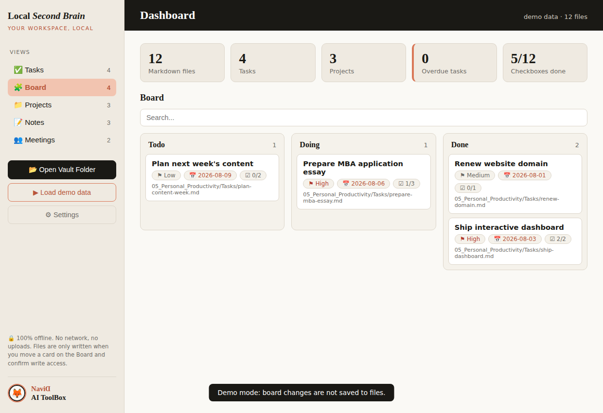

# Local Second Brain

A free, local-first, open-source alternative to Notion.

Capture, organize, and retrieve your knowledge using only local Markdown files — no subscriptions, no cloud lock-in, full privacy. Works with Obsidian and any LLM.

## ✨ Why Local Second Brain?

- **Complete Local System** — everything stored in plain Markdown files you own
- **Notion-style Workspace** — databases, projects, tasks, meeting notes, wiki
- **Interactive Dashboard** — a zero-dependency, offline HTML dashboard that reads your vault
- **AI-Ready** — agent prompts included; works with any LLM (cloud or fully local via Ollama)
- **Powerful Queries** — Obsidian + Dataview turn folders into databases
- **Version Controlled** — Git integration for backup and history
- **Cross-Platform** — Windows, macOS, and Linux

## 📁 Folder Structure

```
Local-Second-Brain/
├── 00_System_of_Record/       # Databases, projects, tasks, meetings, wiki, knowledge base
├── 01_AI/              # Agent prompts: custom agents, deep research, AI meeting notes
├── 02_Developer_Platform/     # CLI tools, webhooks, syncs, agent tools
├── 03_Connected_Workspace/    # Integration guides for external tools
├── 04_Business_Workflows/     # CRM, roadmaps, content pipelines
├── 05_Personal_Productivity/  # Personal OS: notes, tasks, goals, habits, reading lists
├── dashboard/                 # Interactive local dashboard (open index.html)
├── templates/                 # Ready-to-use note templates
└── docs/                      # Documentation
```

## 🛠️ Quick Start

### 1. Clone the repo

```bash
git clone https://github.com/Navidaitoolbox1/local-second-brain.git
cd local-second-brain
```

### 2. Run setup

```bash
python setup.py .
```

(or `python setup.py ~/My-Vault` to create the structure elsewhere)

### 3. Open in Obsidian

1. Open Obsidian → **Open folder as vault**
2. Select this folder
3. Install recommended plugins (Dataview, Tasks, Templater)

### 4. Open the dashboard



The dashboard is a single offline HTML file. **It must be run as a local file, not viewed on GitHub** (GitHub only shows the source, it does not execute HTML). To use it:

1. Download/clone the repo to your computer
2. Double-click `dashboard/index.html` so it opens in your browser (Chrome or Edge recommended for the folder picker)
3. Click **▶ Load demo data** to see it working instantly, or **📂 Open Vault Folder** and select this repository folder to load your own notes

The dashboard scans your Markdown files **locally** — tasks, projects, notes, and meetings with stats, overdue detection, search, and filters. No server, no network, nothing leaves your machine.

It also includes:

- **✍️ Edit and create in place** — click any item to open a friendly editor: a title field, Todo/Doing/Done buttons, priority and due-date pickers, and a clean writing area (no YAML in sight). Switch between **✏️ Write** and **👁 Preview** to see the note rendered (headings, checkboxes, lists, quotes, images, links) via a small built-in, XSS-safe Markdown renderer. **Drag an image or a text file onto the note** to add it: images are copied into an `attachments/` folder and linked (or embedded inline when there's no write access), text files are pasted in. Use **＋ New** to create a task, project, note, or meeting from a template. In Chrome or Edge, saving and creating write straight to the Markdown files after you grant write access once; in demo or read-only mode, changes stay in the session.
- **🧩 Board** — a kanban view (Todo / Doing / Done) with drag and drop. Moving a card updates the `status` in the Markdown file. In demo or read-only mode, moves stay on screen only.
- **🗂️ Reorganize by dragging** — drag any item from a list onto another view in the sidebar (for example a note onto **Projects**) to move its file to that folder and update its `type`. Writes to disk in Chrome or Edge with write access; otherwise the move is kept for the session.
- **🔒 PIN lock** — set a PIN in ⚙ Settings to lock the dashboard on your device. Honest note: this locks the dashboard view only; the Markdown files stay readable on disk, so use your OS password or disk encryption for real protection.
- **⚙ Settings** — PIN management, default view, and whether to include `templates/` and `docs/` in the scan. Stored in your browser only.

The repo ships with **starter content** (example task, project, meeting, notes, goal, and agent prompts) so the dashboard and Obsidian show real data on day one. Delete the `example-*` / `welcome-*` files once you're comfortable.

> Want a clickable link instead of a local file? Enable **GitHub Pages** (Settings → Pages → Deploy from branch → `main` / root). Then `https://<user>.github.io/<repo>/dashboard/` runs the dashboard over HTTPS with the full folder picker.

### 5. Start capturing

Drop ideas into `00_System_of_Record/Forms/Inbox.md`, then use the templates in [`templates/`](templates/) to create notes, tasks, and projects.

## 🤖 Using with AI Models

This system is designed to work with any LLM. Just copy a template and ask your model to fill it:

> "Use the Atomic Note template and turn this article into 3 atomic notes."

Ready-made prompts live in [docs/agent-prompts.md](docs/agent-prompts.md). For sensitive notes, use a local model — see [docs/free-llms.md](docs/free-llms.md).

## 📚 Documentation

- [Getting Started](docs/getting-started.md)
- [Obsidian Setup](docs/obsidian-setup.md)
- [Using AI Models](docs/free-llms.md)
- [Dataview Guide](docs/dataview-mastery.md)
- [Agent Prompts](docs/agent-prompts.md)
- [Roadmap to Master Claude](docs/claude-roadmap.md) ([styled version](docs/claude-roadmap.html))

## 🧩 Recommended Tools

- **Obsidian** (core app)
- **Dataview** plugin
- **Tasks** plugin
- **Templater** plugin (needed for `{{date}}` placeholders in templates)
- **Obsidian Git** (backup)

## 📄 License

**PolyForm Noncommercial License 1.0.0** — free to use, modify, and share for any noncommercial purpose. Commercial use requires a separate license from the copyright holder. See [LICENSE](LICENSE) for full terms, or contact taheri.navid@gmail.com to discuss commercial use.

---

**Local Second Brain** — your workspace, organized locally and forever.
